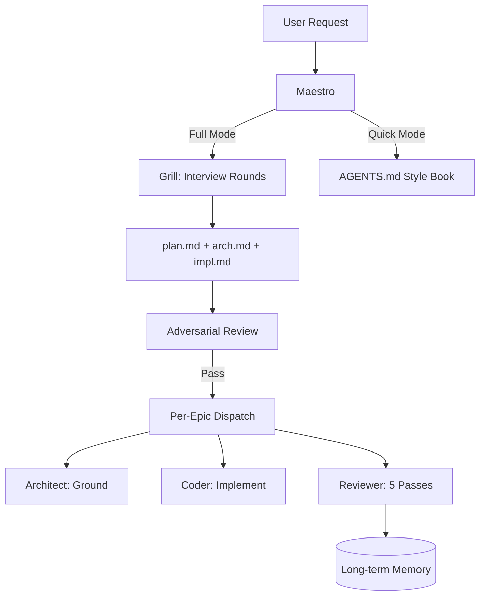

# G-Agent Starter Kit

> Multi-model AI agent framework for software development. Pure Markdown, zero dependencies, **Google Engineering Practices** built-in.


## What It Does

**Orchestrates specialized AI personas** (Architect, Coder, Reviewer, Contextualizer, Maestro) to plan, implement, and review code — with memory across sessions, adversarial review gates, and Google engineering standards enforced at every stage.

**Problem it solves**: AI coding agents work well for single tasks but fail at complex multi-step work requiring planning, structured review, and context persistence. This framework adds that structure without locking you into a runtime or vendor.

## Quick Start (30 seconds)

```bash
# 1. Clone into your project
cd /path/to/your/project
git clone https://github.com/cmellojr/g-agent-starter-kit.git .agents

# 2. Symlink entrypoint (for AI CLI auto-load)
ln -s .agents/AGENTS.md AGENTS.md

# 3. Start your AI CLI (opencode, claude, codex, cursor...)
opencode

# 4. Just type — AGENTS.md auto-loads as your style book
> "Add email validation to the user registration endpoint"
```

**Full orchestration mode** (complex multi-step work):
```text
Please comply with @.agents/ENTRYPOINT.md
```

## Why This Exists

| Need | Typical Approach | This Framework |
|---|---|---|
| Complex feature with unclear scope | Vibe coding → chaos | **Grill** → Architect interviews you, produces plan |
| Code quality drift | Manual review → inconsistent | **Review loop** → design, coherence, quality, security, docs |
| Context loss between sessions | Re-explain everything | **Memory** → long-term + session persistence |
| Single-model vendor lock-in | One provider, one plan | **Multi-model routing** → Maestro orchestrates, personas route to best model |
| Style guide enforcement | Manual/linter only | **Google Style Guides** → reviewed at every stage |

## Non-Goals

- ❌ Not a hosted SaaS — runs locally in your CLI
- ❌ Not a code generator — it's a *process framework* for agents
- ❌ Not opinionated beyond Google Style Guides — fork and extend
- ❌ Not a replacement for your project's AGENTS.md — it *provides* one

## Architecture



## Personas

| Persona | Role | Humor | Self-Review |
|---|---|---|---|
| **Maestro** | Orchestrator, boot, dispatch | Sympathetic | — |
| **Architect** | Design tree, ground plans | Extrovert | DRAFT |
| **Coder** | Implement per epic | Pragmatic | GRASP |
| **Reviewer** | 5-pass review (design, coherence, quality, security, docs) | Pragmatic | SHIELD |
| **Contextualizer** | `.context.md`, `FEATURE-MAP.md` | Robotic | TRACE |

Each persona has an identity, playbook, handoff format, red lines, and a self-review rubric that scores its own work before delivery.

## Google Engineering Practices (Throughout)

This framework doesn't just *reference* Google standards — it **operationalizes** them:

| Practice | Implementation |
|---|---|
| **Style Guides** | `rules/code/code-style-*.md` for Python, Go, Shell, Rust, Markdown — auto-loaded by review pipeline per file extension |
| **Code Review** | `reviewer-architect-adversarial` (adversarial plan validation) + `review-loop` (5-pass: design, coherence, quality, security, docs) |
| **Testing on the Toilet** | `rules/code/testing-practices.md` — hermetic tests, behavior verification, input-value strategy |
| **SRE / Resiliency** | `rules/code/quality.md` v0.4+ — truncated exponential backoff with jitter, retry budgets, structured JSON logging with trace/span IDs |
| **API Design** | `rules/code/api-design.md` — resource naming, standard methods, Google REST conventions |
| **CL Author Guidelines** | Small CLs, descriptive messages (why, not what), atomic commits per `rules/git.md` (cbea.ms format) |
| **Documentation** | `.context.md` per directory + `docs/FEATURE-MAP.md` — updated in same commit as code changes |

## Rules (Google Style Guides)

| Language | Guide |
|---|---|
| Python | `rules/code/code-style-python.md` |
| Go | `rules/code/code-style-go.md` |
| Shell | `rules/code/code-style-shell.md` |
| Rust | `rules/code/code-style-rust.md` |
| Markdown | `rules/code/code-style-markdown.md` |

**Universal** (all languages): `quality.md`, `general.md`, `api-design.md`, `testing-practices.md`, `debugging.md`, `shell.md`

Rules use RFC language: **MUST/MUST NOT** = blockers; **SHOULD/SHOULD NOT** = require visible justification.

## Skills (Key Ones)

| Skill | Purpose |
|---|---|
| `boot` | Session startup: auto-update, memory, CLI config, context check |
| `grill` + `plan-management` | Structured planning → interview rounds → grounded epics |
| `dispatch` | Multi-provider routing (Claude, Codex, Cursor, DeepSeek, Gemini, Qwen) |
| `review-loop` | Two-mode: single reviewer per epic, three for full branch |
| `agent-memory` | Long-term + session memory across sessions |
| `context-maintenance` | `.context.md` + `FEATURE-MAP.md` schema and updates |
| `code-sec-review` | OWASP 2025 + MITRE ATT&CK static analysis |
| `upstream-sync` | Keep fork aligned with upstream (policy-driven merge) |

[Full skills catalog → `skills/README.md`](skills/README.md)

## Customization

- **Providers/Models** → `skills/dispatch/SKILL.md` (Providers list)
- **Personas** → `personas/` (schema in `personas/README.md`)
- **Rules** → `rules/code/` (or `AGENTS.override.md` in your project root)
- **Skills** → `skills/` (schema in `skills/README.md`)
- **Your project conventions** → edit `AGENTS.md` (auto-loaded in quick mode)

## Documentation

- `docs/roadmap.md` — Google alignment plan (Phases 1–15)
- `docs/FEATURE-MAP.md` — feature → code path index
- `docs/CONTRIBUTING.md` — contribution guidelines
- `docs/FAQ.md` — frequently asked questions
- `.context.md` (per directory) — local orientation for agents/humans

## License

Apache 2.0 — see [LICENSE](LICENSE)

---

## See Also

- [AGENTS.md spec](https://agents.md) — README for agents (separate from this human-facing README)
- [Google Style Guides](https://google.github.io/styleguide/)
- [Google Engineering Practices](https://google.github.io/eng-practices/)
- [Google API Design Guide](https://cloud.google.com/apis/design)
- [Google SRE Books](https://sre.google/books/)